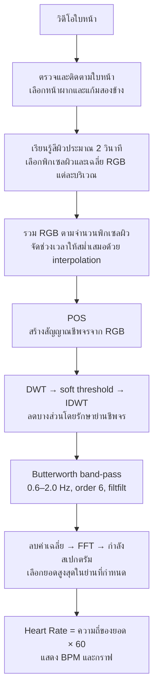

# Pipeline ของ ippg_v2_refactored.py

ตรวจจากโค้ดปัจจุบัน 2026-11-04 เส้นทางนี้ใช้กับ run_ippg.py ที่ตั้ง POS, DWT, ROI legacy และ background none



## ความหมายแต่ละขั้น

| ขั้น | พฤติกรรมจริง | ผลที่ส่งต่อ |
|---|---|---|
| อ่านวิดีโอ | อ่าน frame/FPS ของไฟล์; เวลาเฟรม = frame number/FPS | ภาพและแกนเวลาจาก metadata |
| ติดตามใบหน้า | MediaPipe Face Landmarker + EMA ของตำแหน่ง; ใช้ Haar เมื่อ MediaPipe เริ่มทำงานไม่ได้ | พื้นที่หน้าผากและแก้มซ้าย/ขวา |
| เลือกผิว | เรียนรู้ Cr/Cb จากช่วงประมาณ 2 วินาทีแรกที่พบหน้า; ใช้ HSV ช่วยคัดสี, EMA mask และ morphology | mask ของพิกเซลผิว; warm-up ไม่อยู่ในชุดคำนวณสุดท้าย |
| เฉลี่ย/รวมสี | ค่าเฉลี่ย R/G/B ของพิกเซลผิวแต่ละพื้นที่; ให้น้ำหนักตามจำนวนพิกเซลผิวในโหมด legacy | RGB รวมหนึ่งชุดต่อเฟรมที่ใช้ได้ |
| จัดเวลา | Linear interpolation บน grid ตาม video FPS | RGB ที่ช่วงเวลาสม่ำเสมอ; ไม่ได้เพิ่มการวัดจริง |
| POS | Normalize RGB ในหน้าต่างซ้อนทับ 1.6 วินาที, รวมสอง projection ตามอัตรา std, ลบค่าเฉลี่ยและ overlap-add | Raw pulse หนึ่งเส้น |
| DWT | db4, level auto=min(4,max_supported), symmetric, soft threshold, strength 1; sigma จาก MAD ของ cD1 | Reconstructed pulse |
| รักษาย่านชีพจรใน DWT | คง approximation และ detail ที่ช่วงความถี่ประมาณทับ 0.6–2.0 Hz; threshold เฉพาะ detail อื่น | ไม่ได้ใช้ cPPG ปรับ threshold และไม่รับประกันว่า BPM แม่นขึ้น |
| Band-pass | Butterworth order 6, 0.6–2.0 Hz, forward/backward filtfilt | Filtered pulse |
| FFT/เลือกยอด | จัด grid อีกครั้ง, ลบค่าเฉลี่ย, rFFT; เมื่อ background none ใช้ abs(FFT)^2 แล้วเลือก bin สูงสุดในย่าน | ความถี่หลักและ BPM; ไม่มี Hann window ในเส้นทางนี้ |

POS ภายในแต่ละ window ใช้ RGB ที่ normalize แล้ว:

```text
S1 = G − B
S2 = G + B − 2R
alpha = std(S1) / std(S2)     # มี guard เมื่อ std(S2) ใกล้ศูนย์
pulse = S1 + alpha × S2
```

หน้าต่าง POS 1.6 วินาทีไม่ใช่การรายงาน BPM ทุก 1.6 วินาที โปรแกรมปัจจุบันสรุป FFT BPM หนึ่งค่าจากช่วงที่วิเคราะห์ทั้งหมด
ช่วง 0.6–2.0 Hz เท่ากับ 36–120 BPM; เช่น peak 1.8 Hz จะได้ 108 BPM

## ตัวเลือกที่ไม่เปิดในเส้นทางเริ่มต้น

- G−R: เลือกแทน POS ด้วย pulse_method=g-r; ไม่ใช่ขั้นที่ทำต่อจาก POS และไม่ทำ DWT ในเส้นทางนี้
- POS+ICA: เลือกแทน POS ด้วย pulse_method=pos-ica เพื่อรวมสองวิธี ไม่ได้เปิดอัตโนมัติ
- ROI quality-selected patches: เปิดด้วย roi_method=quality; ค่าเริ่มต้น legacy คือรวมตามจำนวนพิกเซลผิว ไม่ใช่การเลือก patch ตามคะแนน
- Background legacy/power: ปิดอยู่ ค่าเริ่มต้น none; ไม่ดึงฉากหลังและไม่ลบสัญญาณฉากหลัง
- ปิด DWT ได้ด้วย denoise=none
- cPPG/ground_truth.txt ไม่ใช่ input ของการหา BPM จากวิดีโอ เป็นงานเปรียบเทียบภายนอก
- มีการป้องกันข้อมูลสั้น/สัญญาณแบนและไม่มี peak แต่ยังไม่มี quality gate ที่สมบูรณ์สำหรับหลาย peak หรือผลไม่คงที่ระหว่างช่วง

## ระยะเวลาขึ้นกับวิธีเรียก

| วิธีเรียก | ระยะเวลาที่กำหนด |
|---|---|
| run_ippg.py ปัจจุบัน | None = ทั้งคลิป |
| รัน ippg_v2_refactored.py ผ่าน CLI ไม่ส่ง --duration | จำกัด 34.333 วินาทีแรก |
| ใช้ IPPGConfig() ตรง ๆ โดยไม่ระบุ max_duration_seconds | จำกัด 30 วินาทีแรก |

ทุกแบบมีช่วง calibration ตอนต้นที่ไม่รวมใน pulse สุดท้าย จึงอาจเห็นกราฟเริ่มหลังประมาณ 2 วินาที
เอกสารนี้อธิบายพฤติกรรมโค้ด ไม่ได้เปลี่ยนอัลกอริทึมหรือยืนยันความแม่นยำทางการแพทย์
